# Administration Tools

**Two self-hosted web tools for an institution's marketing and media team: a branded social-post
generator and a photo-to-video slideshow maker.**


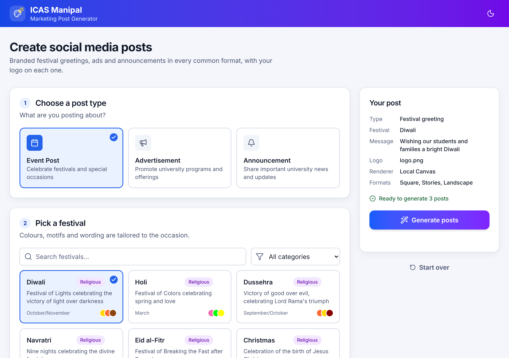

---

## Overview

Small marketing teams spend a lot of time on two repetitive jobs:

1. **Resizing the same post for every platform.** A Diwali greeting, an admissions ad or a campus
   announcement has to exist as an Instagram square, a Story, a YouTube thumbnail, a LinkedIn
   banner and so on, each with the logo in the right place.
2. **Turning event photos into a short video** with transitions and a soundtrack, without opening
   a video editor.

This repository contains one tool for each, kept in a single npm-workspaces monorepo:

| App                                                       | What it does                                                                                                                                                        | Runs as                                         |
| --------------------------------------------------------- | ------------------------------------------------------------------------------------------------------------------------------------------------------------------- | ----------------------------------------------- |
| [**Marketing Post Generator**](#marketing-post-generator) | Builds festival greetings, advertisements and announcements in up to five social-media formats at once, rendered locally or with an AI image model, with your logo. | Static site (+ an API-key proxy for AI models)  |
| [**Photo to Video Converter**](#photo-to-video-converter) | Turns up to 20 photos into an MP4 slideshow with cross-fades, then optionally adds background music or an AI-written, AI-voiced narration.                          | One Node.js process (Express API + FFmpeg + UI) |

**Who it's for:** the people who run an institution's social channels (the defaults are set up for
_ICAS Manipal_, but the brand name is configurable), and the developer who hosts the tools for them.
Both apps work **without any API keys**; AI features switch on when keys are added.

## Contents

- [Screenshots](#screenshots)
- [Features](#features)
- [Tech stack](#tech-stack)
- [Architecture](#architecture)
- [Project structure](#project-structure)
- [Getting started](#getting-started)
- [Configuration](#configuration)
- [Running in development and production](#running-in-development-and-production)
- [Usage](#usage)
- [API reference (Photo to Video)](#api-reference-photo-to-video)
- [Scripts](#scripts)
- [Testing](#testing)
- [Linting and formatting](#linting-and-formatting)
- [Deployment](#deployment)
- [Troubleshooting and FAQ](#troubleshooting-and-faq)
- [Known limitations](#known-limitations)
- [Roadmap ideas](#roadmap-ideas)
- [Contributing](#contributing)
- [License](#license)

## Screenshots

All screenshots were captured from the apps running locally, using generated demo images and a
placeholder logo.

### Marketing Post Generator

| Generated posts (local renderer, with logo)                             | Dark theme                                         |
| ----------------------------------------------------------------------- | -------------------------------------------------- |
| 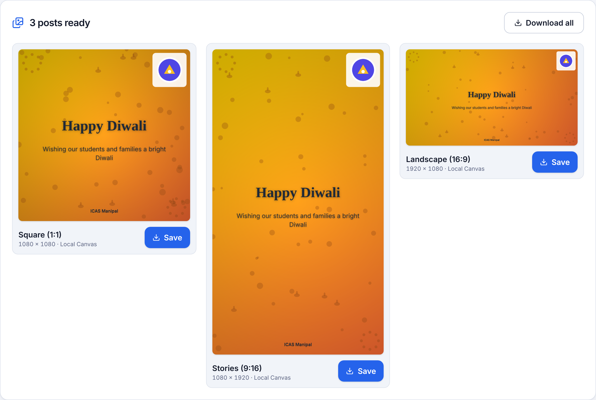 | 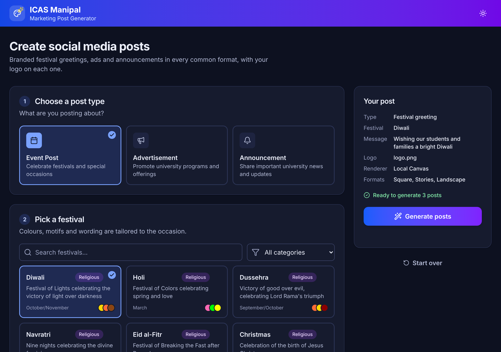 |

<p align="center">
  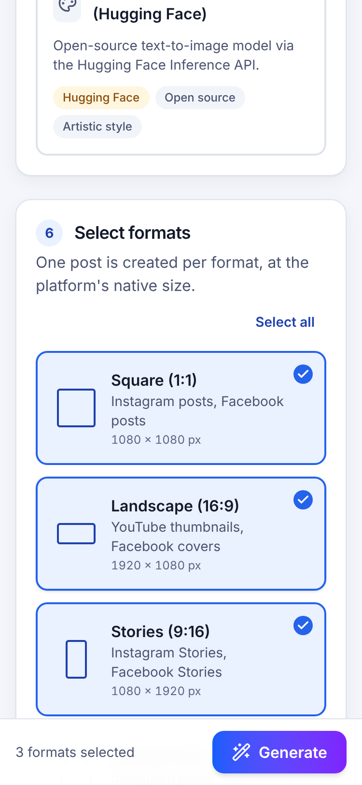
</p>

### Photo to Video Converter

| 1. Choose photos                                  | 2. Video settings                                     |
| ------------------------------------------------- | ----------------------------------------------------- |
| 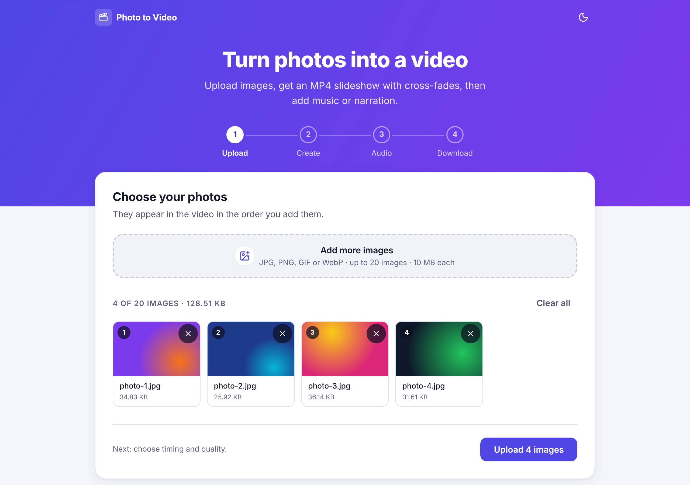 | 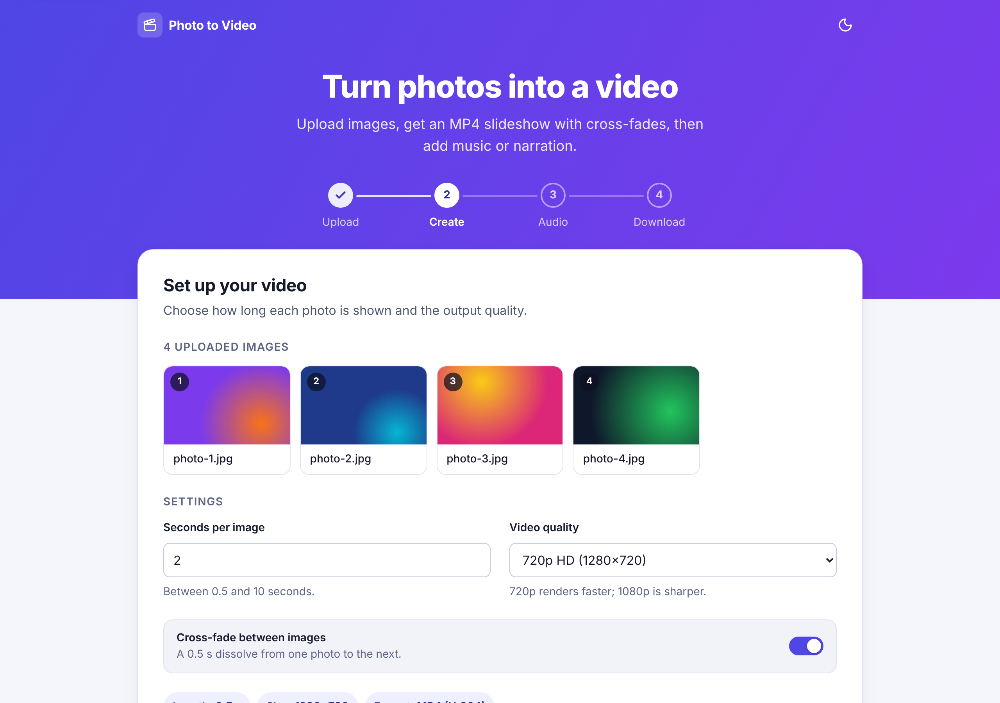 |

| 4. Preview and download                           | 3. Audio step on a phone (dark theme)                                                              |
| ------------------------------------------------- | -------------------------------------------------------------------------------------------------- |
| 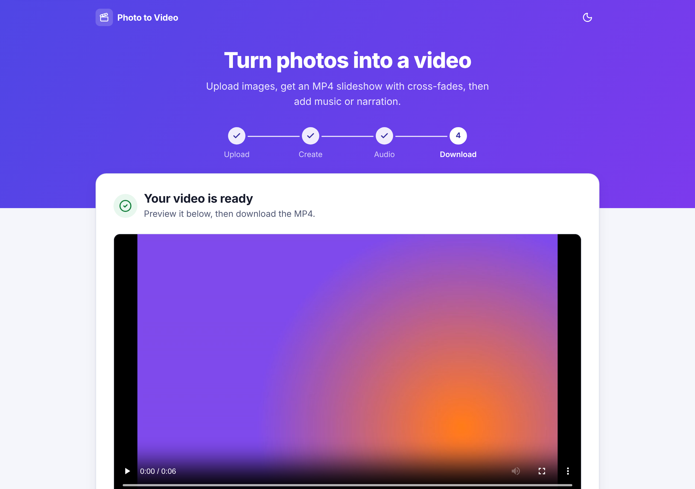 | 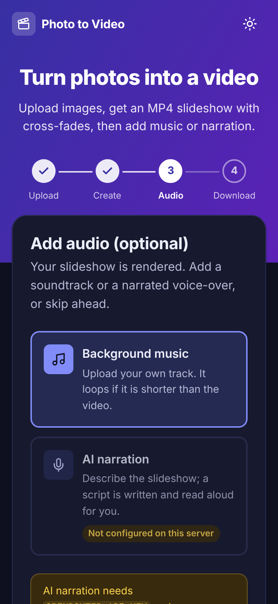 |

## Features

### Marketing Post Generator (`apps/marketing-tool`)

- **Three post types:** festival/event greetings, advertisements and announcements.
- **20 Indian festivals** with colour palettes, dates and cultural keywords; searchable and
  filterable by category (religious, cultural, national, seasonal).
- **Five formats in one go**, each at its native size: Square 1:1 (1080×1080), Landscape 16:9
  (1920×1080), Stories 9:16 (1080×1920), Portrait 4:5 (1080×1350) and Banner 2:1 (1500×750).
- **Local renderer (default, no keys):** draws each post on a `<canvas>` with the festival's
  palette, automatically chosen high-contrast text, word-wrapped headline and subtitle, and motifs
  (diyas, rangoli, mandala, crescent moon, confetti). Falls back to SVG if canvas is unavailable.
- **Optional AI models:** a text model on OpenRouter writes an art-direction prompt, then
  **Gemini 2.5 Flash Image** (via OpenRouter) or **Stable Diffusion XL** (via Hugging Face) draws
  the artwork, which is cropped to each format.
- **Logo overlay** on every post, AI or local.
- **Graceful degradation:** if an AI call fails for a format, that post is rendered locally and the
  UI says which model failed and why.
- **No secrets in the browser:** the frontend calls `/api/openrouter/*` and `/api/huggingface/*`;
  a server-side proxy adds the keys.
- **UI:** numbered steps, a sticky summary with a to-do list on desktop and a fixed "Generate" bar
  on phones, skeleton placeholders while generating, per-post and "Download all" downloads, light
  and dark themes.

### Photo to Video Converter (`apps/photo-to-video`)

- **Upload** up to 20 JPG/PNG/GIF/WebP images (10 MB each) by drag-and-drop, file picker or
  keyboard, with thumbnails, per-file removal and "Clear all".
- **Render** an H.264 MP4 at 720p or 1080p. Each image is letter-boxed and shown for 0.5–10 s, with
  optional 0.5 s cross-fades (FFmpeg `xfade`). Progress comes from FFmpeg's own output.
- **Background music:** MP3/WAV/OGG/M4A/AAC up to 25 MB; loops if shorter than the video.
- **AI narration:** describe the slideshow, OpenRouter writes a 30–60 s script, ElevenLabs reads it,
  and the voice-over is muxed in. If the keys are missing, the option is disabled with an
  explanation (via [`GET /api/config`](#api-reference-photo-to-video)).
- **Preview and download** in the browser, with Range support so seeking works.
- **No FFmpeg on the server?** The UI offers an in-browser fallback that records the slideshow from
  a canvas with `MediaRecorder` and downloads a WebM.
- **Hardened API:** server-generated `<uuid>.<ext>` file names (no path traversal), strict request
  validation, per-job outputs, no shell invocation.

### Shared UI/UX

- Design tokens (spacing, type scale, radii, semantic colours) with **light and dark themes** that
  follow the OS and can be switched with a remembered toggle (no flash on load).
- **Accessible:** semantic landmarks, skip links, labelled controls, `aria-pressed` toggles, live
  regions for progress, visible focus rings, 44 px touch targets, WCAG AA colour contrast and
  `prefers-reduced-motion` support. Keyboard focus follows the step changes in the video app.
- **Responsive** from 320 px phones to wide desktops, checked at 375, 768 and 1280 px.
- **Clear states** for loading, empty, error and success everywhere data is fetched or submitted,
  plus a **404 view** for unknown paths.
- Per-page titles, meta descriptions, Open Graph tags and images, SVG favicons.

## Tech stack

| Layer         | Marketing Post Generator                                   | Photo to Video Converter                                     |
| ------------- | ---------------------------------------------------------- | ------------------------------------------------------------ |
| UI            | React 19, TypeScript 5.8                                   | React 19, TypeScript 5.8                                     |
| Styling       | Tailwind CSS 4 (theme tokens + component classes)          | Plain CSS with custom-property design tokens                 |
| Icons         | lucide-react                                               | lucide-react                                                 |
| Build / dev   | Vite 7                                                     | Vite 7 (frontend), `tsx` (server)                            |
| Backend       | None: Vite dev/preview proxy or your reverse proxy for AI  | Express 5, multer, axios                                     |
| Media         | Canvas 2D API (PNG), SVG fallback                          | FFmpeg + ffprobe (`xfade`, scale/pad, `amix`), MediaRecorder |
| AI (optional) | OpenRouter (prompt + Gemini 2.5 Flash Image), Hugging Face | OpenRouter (script), ElevenLabs (text-to-speech)             |
| Tests         | Vitest 5                                                   | Vitest 5, Supertest, real FFmpeg integration tests           |
| Quality       | ESLint 9 (typescript-eslint, React Hooks), Prettier 3      | ESLint 9 (typescript-eslint, React Hooks), Prettier 3        |
| Runtime       | Any static host                                            | Node.js ≥ 20.12 (22 recommended)                             |

## Architecture

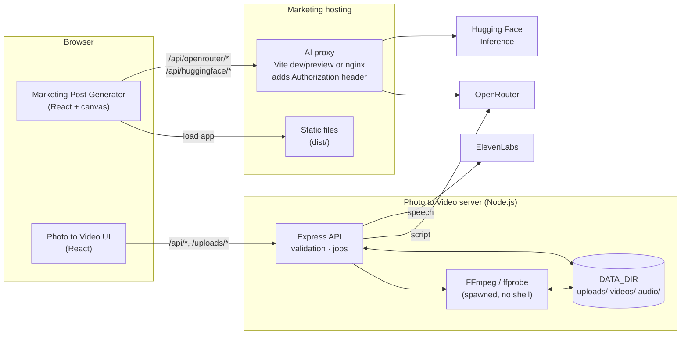

### Marketing Post Generator: generation pipeline

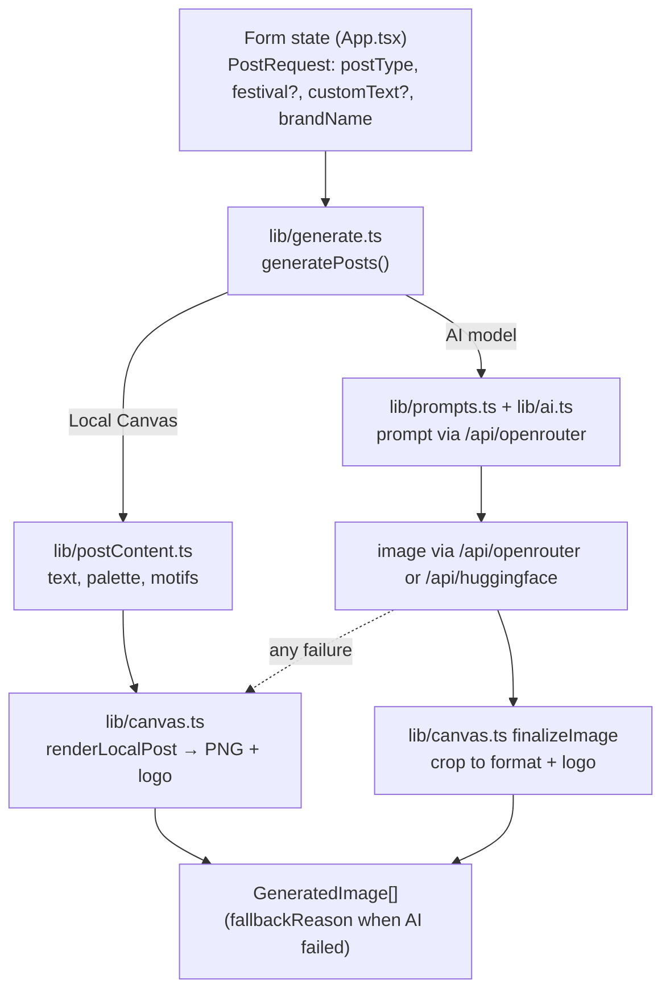

Keys are read from **non-`VITE_`** environment variables, so Vite never bundles them. Providers
without a key are not proxied at all: requests get a local 404 and the app falls back to local
rendering.

### Photo to Video Converter: request flow

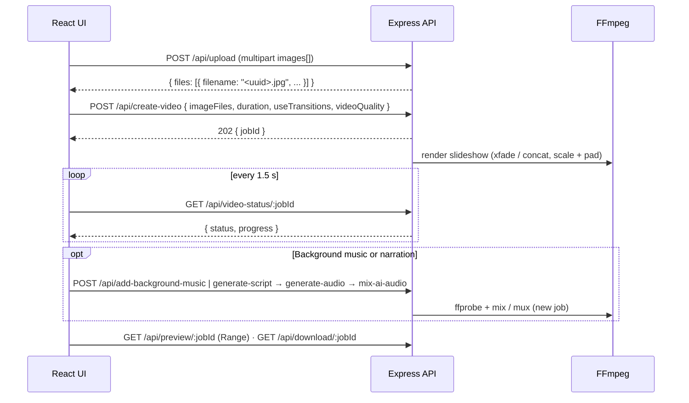

Server modules:

- `server/app.ts` builds the Express app via `createApp()`. AI services, the FFmpeg runner and the
  feature flags are injectable, which keeps it testable. `server/index.ts` loads `.env`, then
  listens.
- `server/lib/validation.ts` parses requests strictly. Client file references must match the
  server's `<uuid>.<ext>` naming.
- `server/lib/ffmpeg.ts` contains pure argument builders plus a small `spawn` wrapper.
- `server/lib/jobs.ts` is an in-memory job store (jobs are lost on restart).
- In development, Vite proxies `/api` and `/uploads` to the API. In production, Express serves the
  built frontend from `dist/` with an SPA fallback, so everything is same-origin.

## Project structure

```
.
├── apps/
│   ├── marketing-tool/                 # Marketing Post Generator (static React app)
│   │   ├── public/                     # favicon.svg, og-image.png
│   │   ├── src/
│   │   │   ├── components/
│   │   │   │   ├── Section.tsx         # Numbered form-section card
│   │   │   │   ├── PostTypeSelector.tsx, FestivalSelector.tsx, CustomTextInput.tsx,
│   │   │   │   │   LogoUploader.tsx, ModelSelector.tsx, AspectRatioSelector.tsx
│   │   │   │   ├── GeneratePanel.tsx   # Sticky summary, to-do list, Generate button
│   │   │   │   ├── GeneratedPosts.tsx  # Skeletons, results grid, downloads
│   │   │   │   ├── Header.tsx, ThemeToggle.tsx, NotFound.tsx, ErrorBoundary.tsx
│   │   │   ├── data/                   # festivals.ts (festivals, post types, formats), models.ts
│   │   │   ├── hooks/                  # useObjectUrl, usePostGeneration, useTheme
│   │   │   ├── lib/                    # prompts, ai client, postContent, canvas, generate (+ *.test.ts)
│   │   │   ├── types/                  # Shared TypeScript types
│   │   │   ├── config.ts               # VITE_* settings
│   │   │   └── index.css               # Tailwind theme tokens, dark theme, component classes
│   │   ├── vite.config.ts              # Tailwind plugin + server-side AI proxy
│   │   └── .env.example
│   └── photo-to-video/                 # Photo to Video Converter (React + Express)
│       ├── public/                     # favicon.svg, og-image.png
│       ├── server/
│       │   ├── lib/                    # validation, ffmpeg, jobs, ai (+ *.test.ts)
│       │   ├── app.ts                  # Express app factory (+ app.test.ts)
│       │   ├── config.ts               # Environment → ServerConfig
│       │   └── index.ts                # Entry point (loads .env, listens)
│       ├── src/
│       │   ├── components/             # ImageUploader → VideoProcessor → AudioProcessor → VideoDownloader,
│       │   │                           #   plus ClientVideoCreator, ProgressBar, ErrorMessage, ThemeToggle, NotFound
│       │   ├── hooks/useTheme.ts
│       │   ├── lib/                    # API client, formatting helpers (+ tests)
│       │   ├── index.css               # Design tokens and light/dark themes
│       │   └── App.css                 # Component styles
│       ├── vite.config.ts              # Dev proxy to the API
│       └── .env.example
├── docs/screenshots/                   # Images used in this README
├── package.json                        # Workspaces and root scripts
├── .nvmrc                              # Node 22
├── .editorconfig, .prettierrc.json, .prettierignore
└── README.md
```

## Getting started

### Prerequisites

| Requirement | Version                                                       | Needed for                                                       |
| ----------- | ------------------------------------------------------------- | ---------------------------------------------------------------- |
| Node.js     | ≥ 20.12 (22 recommended)                                      | Both apps (`.nvmrc` pins 22; `process.loadEnvFile` needs 20.12+) |
| npm         | 10+ (ships with Node 22)                                      | Workspaces install                                               |
| FFmpeg      | Any recent build with `ffprobe` and the `xfade` filter (4.3+) | Photo to Video rendering and its integration tests               |
| API keys    | Optional                                                      | OpenRouter, Hugging Face, ElevenLabs (AI features only)          |

Install FFmpeg with `brew install ffmpeg` (macOS), `sudo apt install ffmpeg` (Debian/Ubuntu),
`winget install Gyan.FFmpeg` (Windows) or from [ffmpeg.org](https://ffmpeg.org/download.html). Check it
with `ffmpeg -version`.

### Installation

```bash
# 1. Clone and enter the repository
git clone https://github.com/jeevithg090/administration.git
cd administration

# 2. Use the pinned Node version (optional, with nvm)
nvm use

# 3. Install both apps (npm workspaces, one lockfile)
npm install

# 4. Optional: configure API keys and branding
cp apps/marketing-tool/.env.example apps/marketing-tool/.env
cp apps/photo-to-video/.env.example apps/photo-to-video/.env

# 5. Verify everything: format check, lint, tests and production builds
npm run check
```

## Configuration

Each app reads its own `apps/<app>/.env`. **Never commit `.env` files** (they are git-ignored).
Every variable is optional.

### `apps/marketing-tool/.env`

| Variable               | Required | Default                                      | Where it's read             | Description                                                 |
| ---------------------- | -------- | -------------------------------------------- | --------------------------- | ----------------------------------------------------------- |
| `OPENROUTER_API_KEY`   | No       | –                                            | Vite proxy (server side)    | Enables prompt writing and the Gemini 2.5 Flash Image model |
| `HUGGINGFACE_API_KEY`  | No       | –                                            | Vite proxy (server side)    | Enables Stable Diffusion XL                                 |
| `HUGGINGFACE_BASE_URL` | No       | `https://router.huggingface.co/hf-inference` | Vite proxy (server side)    | Hugging Face inference endpoint                             |
| `VITE_BRAND_NAME`      | No       | `ICAS Manipal`                               | Browser bundle (build time) | Name shown in the header, on posts and in prompts           |
| `VITE_AI_PROXY_BASE`   | No       | `/api`                                       | Browser bundle (build time) | Base path the frontend uses for AI requests                 |
| `VITE_PROMPT_MODEL`    | No       | `anthropic/claude-3.5-sonnet`                | Browser bundle (build time) | OpenRouter model that writes the image prompt               |

"Server side" variables are only used by the Vite proxy (`npm run dev` / `npm run preview`). In
production, your reverse proxy plays that role (see [Deployment](#deployment)). `VITE_*` values are
compiled into the public JavaScript, so never put secrets in them.

### `apps/photo-to-video/.env`

| Variable              | Required | Default                                 | Description                                                                |
| --------------------- | -------- | --------------------------------------- | -------------------------------------------------------------------------- |
| `PORT`                | No       | `3001`                                  | Port for the API (and the built frontend in production)                    |
| `DATA_DIR`            | No       | `apps/photo-to-video/server`            | Root for `uploads/`, `videos/` and `audio/`                                |
| `CORS_ORIGIN`         | No       | – (CORS disabled)                       | Comma-separated origins, only if the frontend is hosted on another origin  |
| `OPENROUTER_API_KEY`  | No       | –                                       | Narration script generation                                                |
| `OPENROUTER_MODEL`    | No       | `meta-llama/llama-3.2-3b-instruct:free` | Model that writes the narration script                                     |
| `ELEVENLABS_API_KEY`  | No       | –                                       | Text-to-speech for the narration                                           |
| `ELEVENLABS_VOICE_ID` | No       | `pNInz6obpgDQGcFmaJgB`                  | ElevenLabs voice                                                           |
| `ELEVENLABS_MODEL_ID` | No       | `eleven_multilingual_v2`                | ElevenLabs model                                                           |
| `VITE_API_URL`        | No       | – (same origin)                         | Build time: API base URL if the frontend is served from a different origin |
| `API_PROXY_TARGET`    | No       | `http://localhost:3001`                 | Dev only: where the Vite dev server proxies `/api` and `/uploads`          |

AI narration is offered in the UI only when **both** `OPENROUTER_API_KEY` and
`ELEVENLABS_API_KEY` are set. Background music and plain slideshows need no keys.

## Running in development and production

| Goal                               | Command (from the repo root)                                           | URL                                                      |
| ---------------------------------- | ---------------------------------------------------------------------- | -------------------------------------------------------- |
| Marketing tool, dev (hot reload)   | `npm run dev:marketing`                                                | http://localhost:5173                                    |
| Marketing tool, production preview | `npm run build -w marketing-tool && npm run preview -w marketing-tool` | http://localhost:4173                                    |
| Photo to Video, dev (web + API)    | `npm run dev:video`                                                    | http://localhost:5173 (web), http://localhost:3001 (API) |
| Photo to Video, production         | `npm run build -w photo-to-video && npm start -w photo-to-video`       | http://localhost:3001                                    |

Both dev servers use port 5173 by default. To run them side by side, start the second with a
different port, for example `npm run dev -w marketing-tool -- --port 5174`.

## Usage

### Marketing Post Generator: walkthrough

1. **Choose a post type:** Event Post, Advertisement or Announcement.
2. **Pick a festival** (event posts only). Search by name or description, or filter by category.
3. **Write the text.** Required for ads and announcements (it becomes the headline); optional for
   greetings (it becomes the subtitle). Up to 500 characters.
4. **Add your logo** (optional): PNG, JPG, SVG or WebP up to 5 MB, by drag-and-drop or the file
   picker. It goes in the top-right corner of every post.
5. **Choose how to render:** _Local Canvas_ (instant, free, offline) or an AI model.
6. **Select formats**, or use "Select all".
7. Press **Generate posts**. The summary panel lists anything still missing. Results appear below
   with a **Save** button per post and **Download all**. Files are named like
   `post-1x1-1.png`.

If an AI model fails (no key, rate limit, outage), the affected posts are drawn locally and a
notice explains why, for example:

> Gemini 2.5 Flash Image (OpenRouter) was unavailable for 3 of 3 posts, so they were rendered
> locally instead.

### Photo to Video Converter: walkthrough

1. **Choose photos:** drop or browse up to 20 images. They appear in the video in the order added.
2. **Set up the video:** seconds per image (0.5–10), 720p or 1080p, and cross-fades on or off. The
   summary shows the estimated length (cross-fades overlap, so 4 images × 2 s with fades = 6.5 s).
3. **Add audio (optional):** upload a music track, or describe the video to generate a narration.
   Or continue without audio.
4. **Preview and download** the MP4.

### Photo to Video Converter: API example

The UI is a thin client over a JSON API, so you can script it. These responses were recorded from a
local server:

```bash
# Upload two images
curl -F images=@photo-1.jpg -F images=@photo-2.jpg http://localhost:3001/api/upload
```

```json
{
  "message": "Files uploaded successfully",
  "files": [
    {
      "filename": "d7146c05-ebd0-46d5-a73c-ac49c305a51c.jpg",
      "originalName": "photo-1.jpg",
      "size": 35666
    },
    {
      "filename": "67170410-389f-4c3f-afba-96f92b996f19.jpg",
      "originalName": "photo-2.jpg",
      "size": 26545
    }
  ]
}
```

```bash
# Start a render using the server-generated file names
curl -H 'Content-Type: application/json' \
  -d '{"imageFiles":["d7146c05-ebd0-46d5-a73c-ac49c305a51c.jpg","67170410-389f-4c3f-afba-96f92b996f19.jpg"],
       "duration":2,"useTransitions":true,"videoQuality":"720p"}' \
  http://localhost:3001/api/create-video
# → 202 {"jobId":"466fe037-1900-41a9-8f5c-c64d96f32e8d","message":"Video processing started"}

# Poll until completed
curl http://localhost:3001/api/video-status/466fe037-1900-41a9-8f5c-c64d96f32e8d
# → {"id":"466fe037-…","status":"completed","progress":100}

# Download the MP4
curl -o slideshow.mp4 http://localhost:3001/api/download/466fe037-1900-41a9-8f5c-c64d96f32e8d
```

Error responses are JSON with an `error` message:

```bash
curl -H 'Content-Type: application/json' -d '{"imageFiles":["../etc/passwd"]}' \
  http://localhost:3001/api/create-video
# → 400 {"error":"Invalid image file reference"}

curl -H 'Content-Type: application/json' -d '{"videoJobId":"…","videoDescription":"Open day"}' \
  http://localhost:3001/api/generate-script
# → 503 {"error":"Script generation is not configured. Set OPENROUTER_API_KEY in the server environment."}
```

## API reference (Photo to Video)

There is no authentication: put the server behind your own access control before exposing it (see
[Known limitations](#known-limitations)).

| Method | Path                        | Auth | Body                                                        | Success response                                             | Description                                          |
| ------ | --------------------------- | ---- | ----------------------------------------------------------- | ------------------------------------------------------------ | ---------------------------------------------------- |
| GET    | `/api/health`               | None | –                                                           | `200 { status: "ok" }`                                       | Liveness check                                       |
| GET    | `/api/config`               | None | –                                                           | `200 { features: { narration: boolean } }`                   | Which optional AI features are configured            |
| POST   | `/api/upload`               | None | multipart `images[]` (≤ 20, ≤ 10 MB each)                   | `200 { message, files: [{ filename, originalName, size }] }` | Store images under server-generated names            |
| POST   | `/api/create-video`         | None | `{ imageFiles, duration?, useTransitions?, videoQuality? }` | `202 { jobId, message }`                                     | Start a slideshow render                             |
| GET    | `/api/video-status/:jobId`  | None | –                                                           | `200 { id, status, progress, error? }`                       | Poll a video job (`processing`/`completed`/`failed`) |
| GET    | `/api/preview/:jobId`       | None | –                                                           | `200`/`206 video/mp4`                                        | Stream the video (supports `Range`)                  |
| GET    | `/api/download/:jobId`      | None | –                                                           | MP4 attachment                                               | Download the video                                   |
| POST   | `/api/add-background-music` | None | multipart `music` (≤ 25 MB), `videoJobId`                   | `202 { jobId }`                                              | Mix a music track into a finished video (new job)    |
| POST   | `/api/generate-script`      | None | `{ videoJobId, videoDescription }`                          | `200 { script }`                                             | Write a narration script (OpenRouter)                |
| POST   | `/api/generate-audio`       | None | `{ videoJobId, script }`                                    | `202 { audioJobId }`                                         | Synthesize speech (ElevenLabs)                       |
| GET    | `/api/audio-status/:jobId`  | None | –                                                           | `200 { id, status, progress, script, error? }`               | Poll an audio job                                    |
| POST   | `/api/mix-ai-audio`         | None | `{ videoJobId, audioJobId }`                                | `202 { jobId }`                                              | Mux the narration into the video (new job)           |
| GET    | `/uploads/:filename`        | None | –                                                           | image                                                        | Serve an uploaded image (used for thumbnails)        |

Status codes: `400` validation error, `404` unknown job or route, `503` AI key not configured.

The marketing tool has no API of its own. Its proxy forwards `/api/openrouter/*` to
`https://openrouter.ai/api/v1/*` and `/api/huggingface/*` to the Hugging Face inference endpoint.

## Scripts

Run from the repository root:

| Command                 | Description                                                  |
| ----------------------- | ------------------------------------------------------------ |
| `npm run dev:marketing` | Marketing tool dev server with hot reload                    |
| `npm run dev:video`     | Photo-to-video web (Vite) and API (`tsx watch`) together     |
| `npm run build`         | Type-check (`tsc -b`) and build both apps                    |
| `npm run lint`          | ESLint for both apps                                         |
| `npm run typecheck`     | `tsc -b` for frontends, server and config files              |
| `npm test`              | Vitest suites for both apps                                  |
| `npm run format`        | Format everything with Prettier                              |
| `npm run format:check`  | Check formatting without writing                             |
| `npm run check`         | Format check, lint, tests and build: run this before pushing |

Per-app scripts (run with `-w <app>`, e.g. `npm run preview -w marketing-tool`):

| App              | Scripts                                                                                                      |
| ---------------- | ------------------------------------------------------------------------------------------------------------ |
| `marketing-tool` | `dev`, `build`, `preview`, `typecheck`, `lint`, `test`                                                       |
| `photo-to-video` | `dev`, `dev:web`, `dev:server`, `build`, `start` (production server), `preview`, `typecheck`, `lint`, `test` |

## Testing

```bash
npm test                        # both apps
npm test -w photo-to-video      # one app
cd apps/marketing-tool && npx vitest   # watch mode
```

There are **96 tests** (35 in the marketing tool, 61 in photo-to-video):

- **marketing-tool:** post content and colour-contrast logic, word wrapping, SVG escaping, prompt
  templates, the AI client with a mocked `fetch` (including a check that the browser never sends an
  `Authorization` header) and the pipeline's per-image fallback.
- **photo-to-video:** request validation (including path traversal), FFmpeg argument builders,
  the HTTP routes via Supertest (including `/api/config`), and **real FFmpeg integration tests**
  that render a cross-faded slideshow, loop music, stream it with `Range` requests and run the full
  narration flow with stubbed AI services. Integration suites are skipped automatically when
  `ffmpeg` is not installed.

The UI itself has no automated tests in the repository. It was checked manually and with headless
Chromium (Playwright) at 375, 768 and 1280 px in both themes; see [Roadmap ideas](#roadmap-ideas).

## Linting and formatting

- **ESLint 9** (flat config per app) with `typescript-eslint`, `eslint-plugin-react-hooks` and
  `eslint-plugin-react-refresh`. Run `npm run lint`.
- **Prettier 3** with the root `.prettierrc.json` (single quotes, 100-column lines). Run
  `npm run format` or `npm run format:check`.
- **TypeScript** in strict mode, including the Express server (`tsconfig.server.json`). Run
  `npm run typecheck`.
- **EditorConfig** for editors: UTF-8, LF, 2-space indentation.

There is no CI workflow in this repository, so run `npm run check` locally before pushing.

## Deployment

### Photo to Video Converter

One Node process serves the API and the built frontend:

```bash
npm ci
npm run build -w photo-to-video
PORT=3001 DATA_DIR=/var/lib/photo-to-video npm start -w photo-to-video
```

Checklist:

- Install **FFmpeg and ffprobe** on the host.
- Give `DATA_DIR` persistent storage and enough disk space. Uploads and renders are not cleaned up
  automatically.
- Run it under a process manager (systemd, pm2, a container) and put it behind a reverse proxy
  with TLS. Allow request bodies of at least 200 MB if you keep the 20 × 10 MB upload limit
  (e.g. nginx `client_max_body_size 200m;`).
- Add authentication and rate limiting before exposing it publicly.

### Marketing Post Generator

`npm run build -w marketing-tool` produces static files in `apps/marketing-tool/dist`. Host them
anywhere (nginx, S3 + CloudFront, Netlify, GitHub Pages and so on). The local renderer works with no
backend. Set `VITE_BRAND_NAME` (and any other `VITE_*` value) **before** building.

To enable AI models in production, your web server must proxy the same paths the Vite config does
and add the keys server-side. Example for nginx:

```nginx
location /api/openrouter/ {
  proxy_pass https://openrouter.ai/api/v1/;
  proxy_set_header Authorization "Bearer ${OPENROUTER_API_KEY}";
  proxy_set_header Cookie "";
  proxy_ssl_server_name on;
}
location /api/huggingface/ {
  proxy_pass https://router.huggingface.co/hf-inference/;
  proxy_set_header Authorization "Bearer ${HUGGINGFACE_API_KEY}";
  proxy_set_header Cookie "";
  proxy_ssl_server_name on;
}
```

Substitute the keys with `envsubst` or your platform's secret mechanism. Restrict access to the
site, because anyone who can load it can spend your API credits through the proxy.

**SPA fallback and 404s:** both apps are single-page. If your host rewrites unknown paths to
`index.html`, the app shows its own "Page not found" view for any path other than `/`.

**Open Graph images:** `og:image` is set to the relative path `/og-image.png`. Some link-preview
crawlers require an absolute URL, so replace it with your public URL in `index.html` if previews do
not show an image.

## Troubleshooting and FAQ

**Rendering fails with "FFmpeg not found".**
FFmpeg is missing from the server's `PATH`. Install it and restart the server. Until then the UI
offers to record a WebM in the browser instead (no transitions or audio).

**The upload step says "Cannot reach the server. Is the API running?"**
In development, `npm run dev:video` must be running both processes; check the `api` output in the
terminal. If the API is on another host or port, set `API_PROXY_TARGET` (dev) or `VITE_API_URL`
(production build) and `CORS_ORIGIN` on the server.

**AI narration is greyed out ("Not configured on this server").**
Set both `OPENROUTER_API_KEY` and `ELEVENLABS_API_KEY` in `apps/photo-to-video/.env` and restart
the server. `GET /api/config` should then return `{"features":{"narration":true}}`.

**The marketing tool always says the AI model "was unavailable".**
The key for that provider is not set, so the proxy route is not registered (the request gets a
404). Set `OPENROUTER_API_KEY` or `HUGGINGFACE_API_KEY` in `apps/marketing-tool/.env` and restart
`npm run dev` / `npm run preview`. In production, check your reverse-proxy rules. The notice
under the results includes the provider's error message.

**Port 5173 (or 3001) is already in use.**
Pass another port: `npm run dev -w marketing-tool -- --port 5174`, or set `PORT=3002` for the video
server (and `API_PROXY_TARGET=http://localhost:3002` for its dev frontend).

**`npm install` fails or `process.loadEnvFile is not a function`.**
Your Node.js is older than 20.12. Run `nvm use` (Node 22) or upgrade.

**Integration tests were skipped.**
They need `ffmpeg` on the `PATH`; the rest of the suite still runs.

**Where are my uploads and videos stored?**
Under `DATA_DIR` (default `apps/photo-to-video/server/`) in `uploads/`, `videos/` and `audio/`.
They are git-ignored. Delete old files there to free space.

**How do I change the brand name on the posts?**
Set `VITE_BRAND_NAME` in `apps/marketing-tool/.env` and restart the dev server or rebuild.

**Can I force light or dark mode?**
Use the sun/moon button in the header. The choice is stored in `localStorage` under `theme`; clear
it to follow the OS setting again.

## Known limitations

- **No authentication or rate limiting** on the photo-to-video API, and the marketing proxy will
  spend your AI credits for anyone who can reach it.
- **Jobs are kept in memory** and lost on restart. Files under `DATA_DIR` are never cleaned up.
- **No job queue:** every render starts immediately, so many simultaneous renders compete for CPU.
- **AI integrations have not been exercised against live providers in this repository's tests**
  (they are covered with mocks and stubs). The default model slugs (`google/gemini-2.5-flash-image-preview`,
  `anthropic/claude-3.5-sonnet`, `meta-llama/llama-3.2-3b-instruct:free`, `eleven_multilingual_v2`)
  are configurable and may need updating as providers change their catalogues.
- **The in-browser WebM fallback** records in real time, has no transitions or audio, and depends
  on `MediaRecorder` support.
- **Festival dates** are descriptive ("October/November") rather than computed for a given year.
- **Slides cannot be reordered** after selection; remove and re-add images to change the order.
- **No end-to-end UI tests** are committed.

## Roadmap ideas

- Authentication (or SSO) and rate limiting for both tools.
- A persistent job store and scheduled cleanup of `DATA_DIR`.
- Drag-to-reorder slides and per-slide durations.
- Dockerfile with FFmpeg for one-command deployment.
- Playwright end-to-end tests for the main flows in both apps.
- Custom brand colours and fonts for the local renderer.
- Batch "Download all" as a single ZIP.

## Contributing

1. Create a branch from `main`.
2. Install with `npm install` and make your change in the relevant `apps/<app>` workspace.
3. Add or update tests next to the code (`*.test.ts`).
4. Run `npm run check` and make sure it passes.
5. Use [Conventional Commits](https://www.conventionalcommits.org/) (`feat:`, `fix:`, `docs:`,
   `refactor:`, `test:`, `chore:`), scoped to the app where it helps, e.g.
   `fix(photo-to-video): …`.
6. Open a pull request describing what changed and how you verified it. Include screenshots for UI
   changes.

Never commit `.env` files, API keys, uploaded photos or rendered media.

## License

This repository does not include a license file yet, so by default all rights are reserved by the
author. If you intend others to use or contribute to it, adding a license is recommended; the
[MIT License](https://choosealicense.com/licenses/mit/) is a common, permissive choice for a project
like this.
